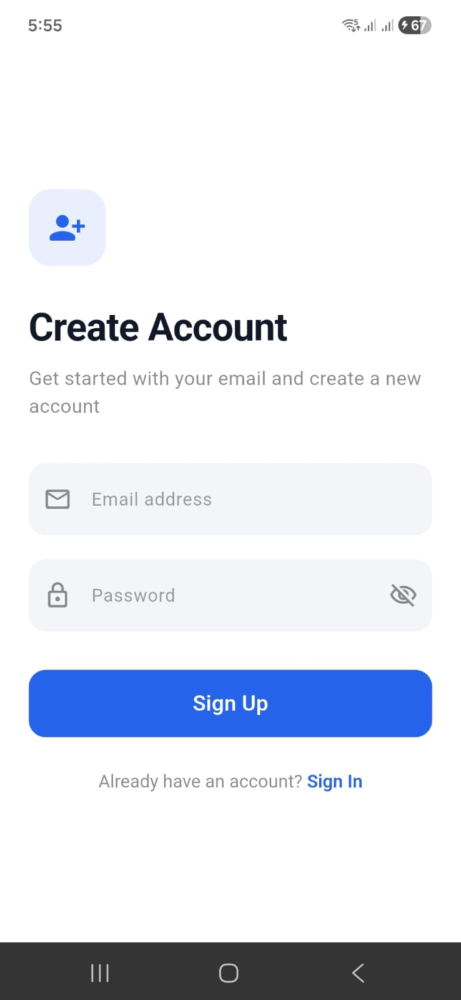
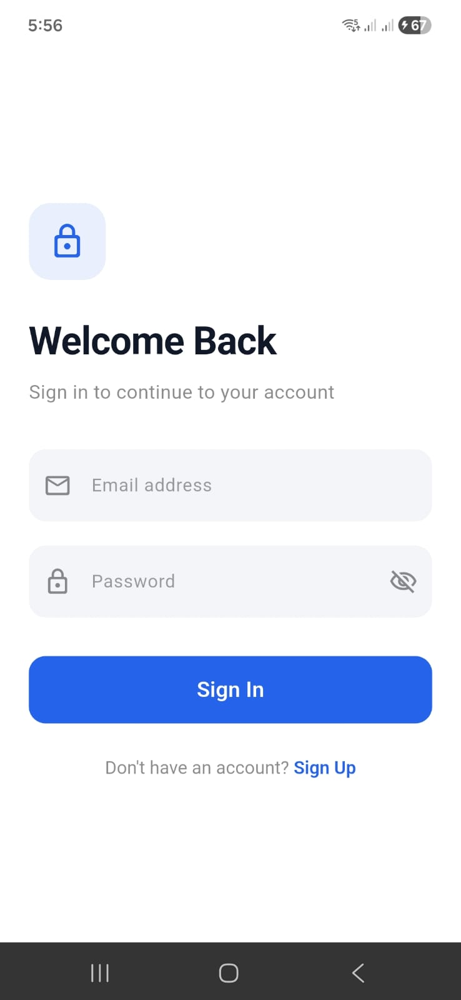
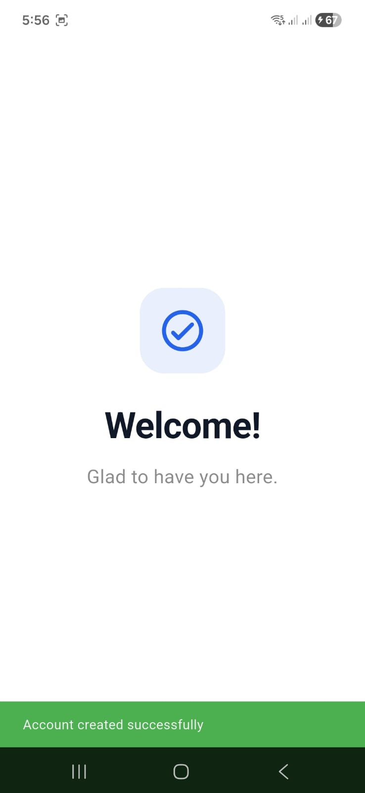

🔐 Flutter Authentication App

A Flutter authentication application built using Firebase Authentication, Cubit, and Clean Architecture.

This project implements a structured authentication flow, including user registration, sign in, form validation, and navigation to the Welcome screen after successful authentication.

✨ Features

📝 User Sign Up

🔑 User Sign In

✅ Form validation

⚠️ Authentication error handling

⏳ Loading states during authentication

🏠 Navigation to the Welcome screen after successful authentication

🛠️ Technologies Used

Flutter & Dart — UI development

Firebase Authentication — User authentication

Cubit (Flutter Bloc) — State management

Clean Architecture — Separation of responsibilities and maintainable code

Dependency Injection — Managing dependencies between components

🏗️ Project Architecture

The project follows Clean Architecture principles and separates the code into three main layers:

Data Layer

Responsible for handling authentication data and communicating with Firebase.

Domain Layer

Contains the core business logic, entities, repository contracts, and use cases.

Presentation Layer

Contains the UI screens and Cubit classes responsible for managing authentication states.

Core

Contains shared components and application-wide functionality, including dependency injection.

## 📱 Screenshots

### Sign Up

### Sign In

### Welcome Screen

🚀 Getting Started

Prerequisites

Flutter SDK

Dart SDK

A Firebase project

Android Studio or VS Code

Installation

Clone the repository:

git clone https://github.com/Madona4/authttt.git

Navigate to the project directory:

cd authttt

Install dependencies:

flutter pub get

Configure Firebase for the application using the Firebase configuration files and setup required for your platform.

Run the application:

flutter run

🎯 Project Goals

Practice implementing authentication with Firebase.

Apply Clean Architecture principles in Flutter.

Manage application state using Cubit.

Improve code organization, maintainability, and separation of concerns.

🙏 Acknowledgment

Special thanks to Eng. Hossam Ezzat for his guidance and support throughout my learning journey.

👩‍💻 Author

Madona Nady

GitHub: Madona4

Built with Flutter 💜
